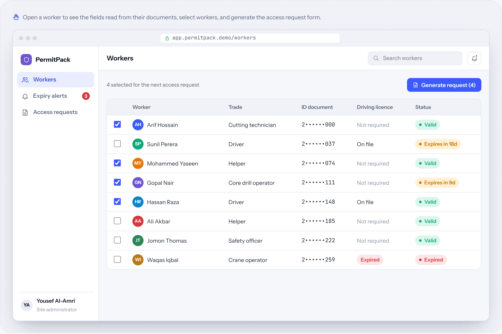
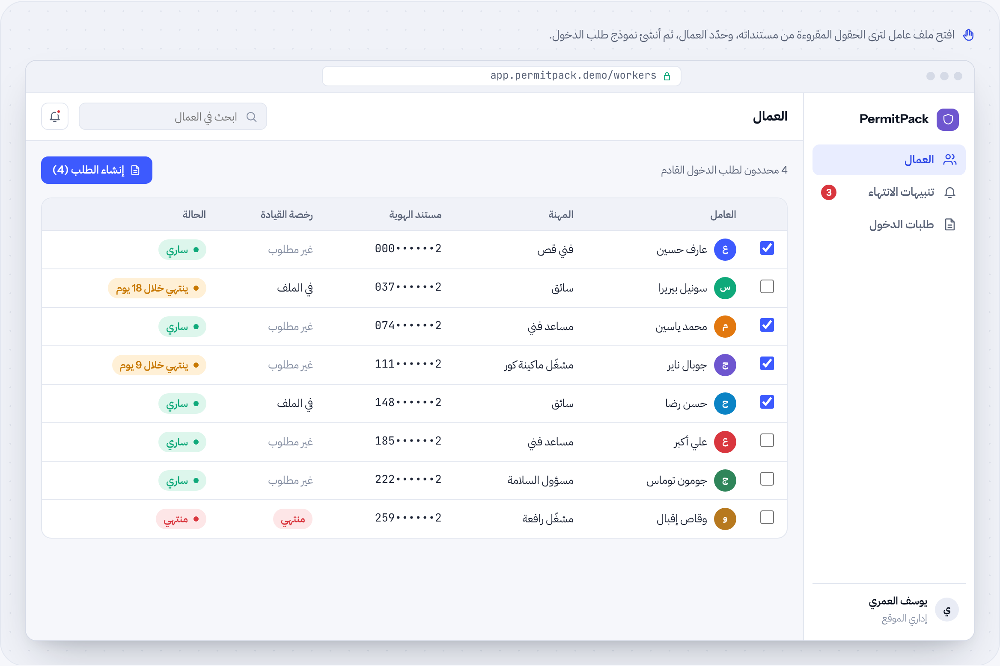

# PermitPack

**Documents → access & compliance forms** · Document AI · by [HUDERA AI](https://www.linkedin.com/company/hudera)

Reads worker IDs and licences, tracks expiry dates, and fills site access request forms in the format the site owner requires.

**[▶ Try the live demo](https://hudera-ai.github.io/permitpack/)** · runs in your browser on sample data · Arabic & English

## The problem
Every new worker or vehicle needs an access request in the owner's format, typed from document photos. Expired documents are discovered at the gate.

## What it does
PermitPack extracts names, numbers, trades and expiry dates from the scanned documents, warns before anything expires, and generates the access request for the selected workers, leaving out anyone whose documents have expired.

## Business value
Requests are prepared from the source documents in the right format, and supervisors hear about expiring documents weeks ahead.

## Features
| Feature | Details |
| --- | --- |
| Field extraction | Names, numbers, trades, dates |
| Expiry alerts | Notify supervisors early |
| Owner's format | Forms filled automatically |
| Masked IDs | Sensitive numbers hidden on screen |
| Worker files | One record per worker |
| Validation | Expired documents excluded |

## How the workflow runs
**Upload**: IDs & licences → **Extract**: Fields & dates → **Watch**: Expiry → **Select**: Workers → **Generate**: Access form

## Typical stack
OCR · LLM extraction · Word/Excel templates · WhatsApp alerts

## Run it locally
Open `index.html` in any modern browser. No build step, no server, no data leaves your machine.

---

## PermitPack بالعربي

**المستندات ← نماذج الدخول والامتثال**

يقرأ هويات العمال ورخصهم، ويتابع تواريخ الانتهاء، ويعبّئ نماذج طلب دخول الموقع بالصيغة التي يطلبها المالك.

### المشكلة
كل عامل أو مركبة جديدة تحتاج طلب دخول بصيغة المالك، يُكتب يدوياً من صور المستندات، والمستندات المنتهية تُكتشف عند البوابة.

### ما الذي يفعله
يستخرج PermitPack الأسماء والأرقام والمهن وتواريخ الانتهاء من المستندات الممسوحة، وينبّه قبل انتهاء أي مستند، ويُنشئ طلب الدخول للعمال المحددين مع استبعاد من انتهت مستنداته.

### القيمة للأعمال
الطلبات تُجهَّز من المستندات الأصلية بالصيغة الصحيحة، والمشرفون يعلمون بالمستندات القريبة من الانتهاء قبلها بأسابيع.

### المزايا
| الميزة | التفاصيل |
| --- | --- |
| استخراج الحقول | الأسماء، الأرقام، المهن، التواريخ |
| تنبيهات الانتهاء | تنبيه المشرفين مبكراً |
| صيغة المالك | النماذج تُعبّأ تلقائياً |
| إخفاء أرقام الهوية | الأرقام الحساسة مخفية على الشاشة |
| ملفات العمال | سجل واحد لكل عامل |
| التحقق | استبعاد المستندات المنتهية |

### كيف يسير العمل
**الرفع**: الهويات والرخص ← **الاستخراج**: الحقول والتواريخ ← **المراقبة**: تاريخ الانتهاء ← **الاختيار**: العمال ← **الإنشاء**: نموذج الدخول

---

## About HUDERA AI
HUDERA AI builds WhatsApp AI assistants, business dashboards, workflow automations and custom SaaS products for companies in Saudi Arabia and the Gulf.

- LinkedIn: [linkedin.com/company/hudera](https://www.linkedin.com/company/hudera)
- Email: hudera.ai@gmail.com
- WhatsApp: [+20 155 515 9139](https://wa.me/201555159139)

> This repository is a product demo. Company names, people and figures inside it are fictional sample data.

© 2026 HUDERA AI. All rights reserved.
